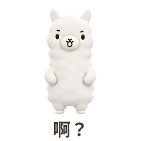
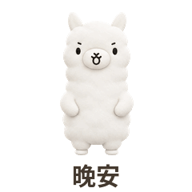

# plush-animated-stickers

一个可独立安装的 AI 技能：从文字描述设计角色，或使用已有卡通参考图，制作 3D 绒毛/软玩偶质感的动画表情包，并交付横幅、透明封面和聊天图标。

## 两种创作入口

- **文字描述 → 角色形象图 → 动作关键帧 → GIF 与配套素材**。
- **已有角色参考图 → 动作关键帧 → GIF 与配套素材**。

文字创作会保存原始描述、设计提示词、角色基准图和身份记录。所有后续动作及配套素材使用同一份基准图。支持先确认形象再继续，也支持在用户授权整套创作后连续制作。

“3D”指成品的材质、体积和光照表现；本技能不包含三维模型、骨骼绑定或 Blender 工程。

## 示例

下面是作者用本技能做的完整一套：白色长身绒毛角色「羊羊」的日常表情。GIF 为 240×240、10 帧时间轴、无限循环，点开可看动效。

|  |  |  |  |
|:--:|:--:|:--:|:--:|
|  |  |  |  |
| 绞尽脑汁 | 收到！ | 马上安排 | 开心！ |
|  |  |  |  |
| 啊？ | 委屈巴巴 | 加油！ | 晚安 |

配套三件套同时产出，不是只给 GIF：

| 详情页横幅 750×400 | 表情封面 240×240（透明） | 聊天图标 50×50（透明） |
|:--:|:--:|:--:|
|  |  |  |

图片放在 [examples/yangyang-daily-v1](examples/yangyang-daily-v1)，说明见该目录 [README](examples/yangyang-daily-v1/README.md)。示例只用于展示效果，尺寸、帧数和文案都是可配置项，不是制作规范或平台要求。

## 安装

将本仓库完整复制到支持 SKILL.md 的客户端技能目录。以 Codex 用户技能目录为例：

```sh
git clone https://github.com/NimaChu/plush-animated-stickers.git ~/.codex/skills/plush-animated-stickers
```

保留整个目录中的 scripts、assets、references、agents 和 requirements.txt，不要只复制 SKILL.md。已有同名安装时先比较版本，避免覆盖本地修改。客户端可能需要重新加载技能列表。

## 使用

在支持该技能的助手中提供角色描述或参考图，例如：

> 使用 $plush-animated-stickers，设计一只奶黄色、圆脑袋短腿、傲娇但心软的绒毛小猫，再制作一套日常动画表情，配齐横幅、封面和图标。

已有图片也可以直接附图并说明动作、文案和使用场景。若想先选角色方案，明确说明“先给我看形象，确认后再做表情”。

## 运行条件

- 新角色和新姿态需要宿主助手提供可用的图像生成工具；技能安装本身不提供模型或 API 权限。
- 本地合成工具需要 Python 3.10+ 和 Pillow 9.1+。在工作区的虚拟环境中安装 requirements.txt，或使用已有环境。
- 有字幕时显式配置可用字体，字体文件由使用者自行提供。
- 已有关键帧可直接用脚本合成，不需要 Blender、NumPy 或图像生成 API。

## 合成与验证

先阅读 [SKILL.md](SKILL.md)，从 [配置示例](assets/config.example.json) 建立自己的配置；输入路径相对配置文件解析，示例路径需替换为实际文件。

```sh
python3 /path/to/plush-animated-stickers/scripts/build_stickers.py --config /path/to/workspace/config.json --check
python3 /path/to/plush-animated-stickers/scripts/build_stickers.py --config /path/to/workspace/config.json --output /path/to/workspace/work/release-v1
python3 /path/to/plush-animated-stickers/scripts/build_stickers.py --verify /path/to/workspace/work/release-v1
```

输出目录必须尚不存在，并且位于技能安装目录之外。成品包包括 upload、sources、manifest.json 和 validation.json。预检与独立复核为只读操作。详见 [配置与独立运行说明](references/compositing.md)。

尺寸、帧序、时长和体积均可配置；示例数值不是微信或其他平台的官方要求。技术验证不代替人物一致性、动作语义、字幕效果和平台规则的人工核验。上传或发布仅按本次用户授权执行。

## 离线测试

```sh
python3 -m unittest discover -s tests -v
```

测试使用几何图形，不调用图像生成服务，覆盖独立复制、跨目录调用、时间/循环/透明度、位移、三件套、来源哈希和拒绝覆盖。它不证明图像模型的角色一致性或审美效果。

## 目录

- SKILL.md：技能入口。
- references/：文字角色设计、关键帧/配套提示词和合成使用说明。
- assets/config.example.json：配置示例。
- scripts/build_stickers.py：配置化 GIF 合成、配套导出与技术验证。
- tests/test_portability.py：离线行为测试。
- agents/openai.yaml：技能显示信息和默认调用提示。
- examples/yangyang-daily-v1/：作者自有角色的成品示例。

本仓库不含私人参考原图、账号凭据或原制作项目。`examples/` 只放作者自有角色的成品演示与说明，不含角色的参考图、身份记录和构建配置，也不构成对其他角色素材的授权。
